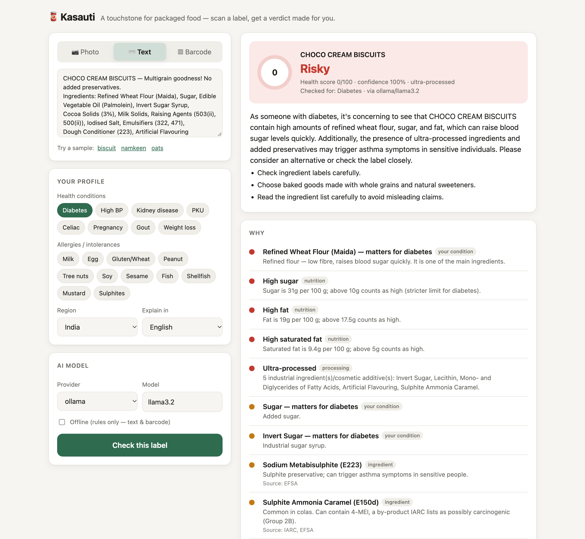
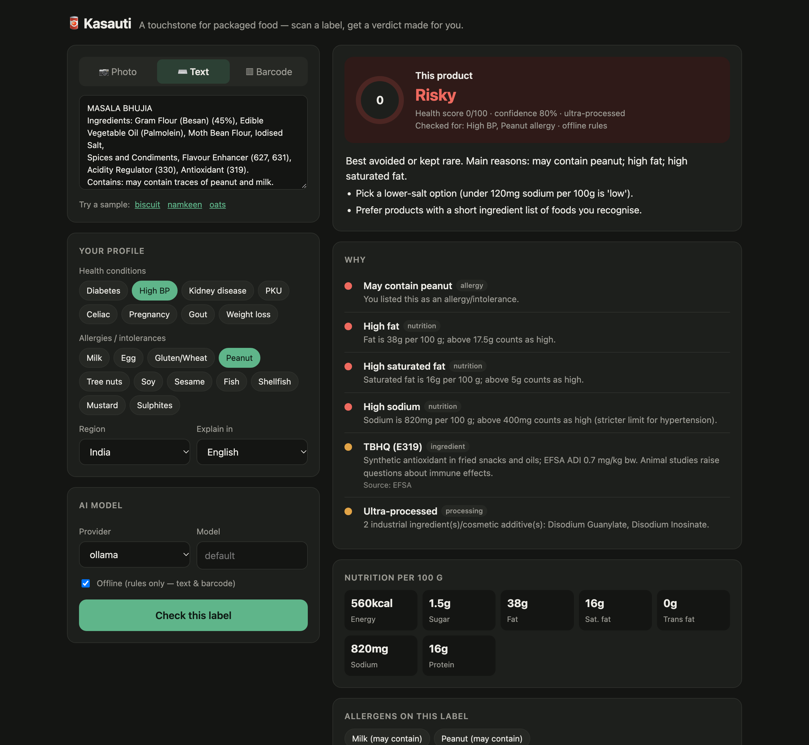
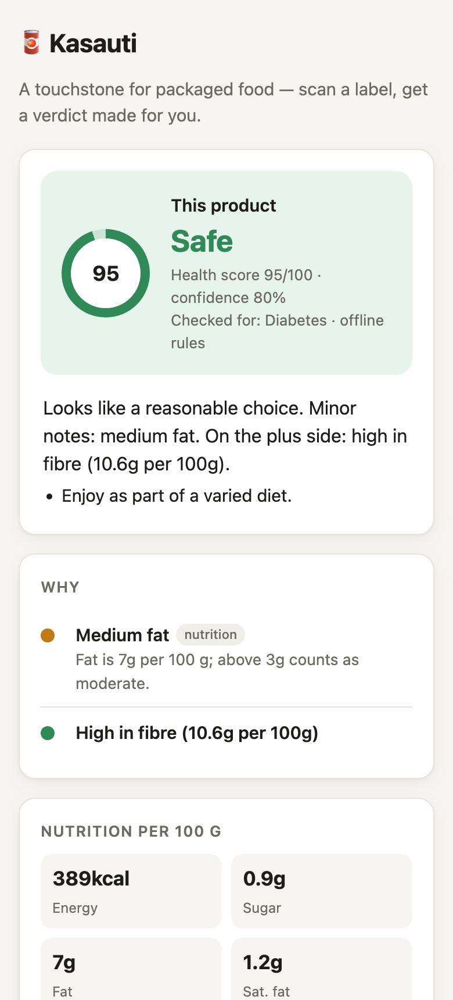
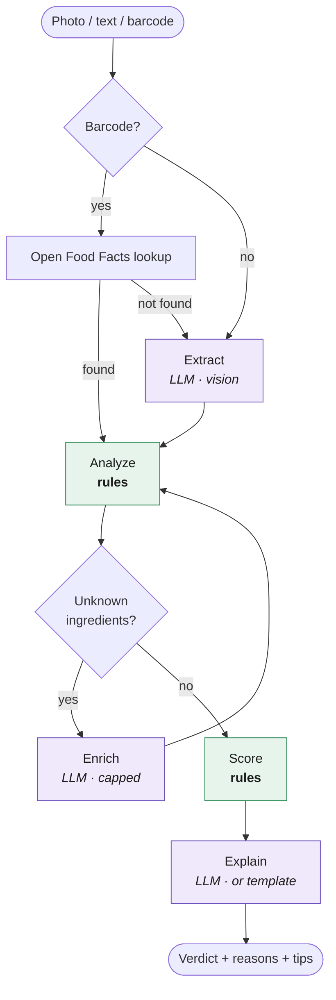
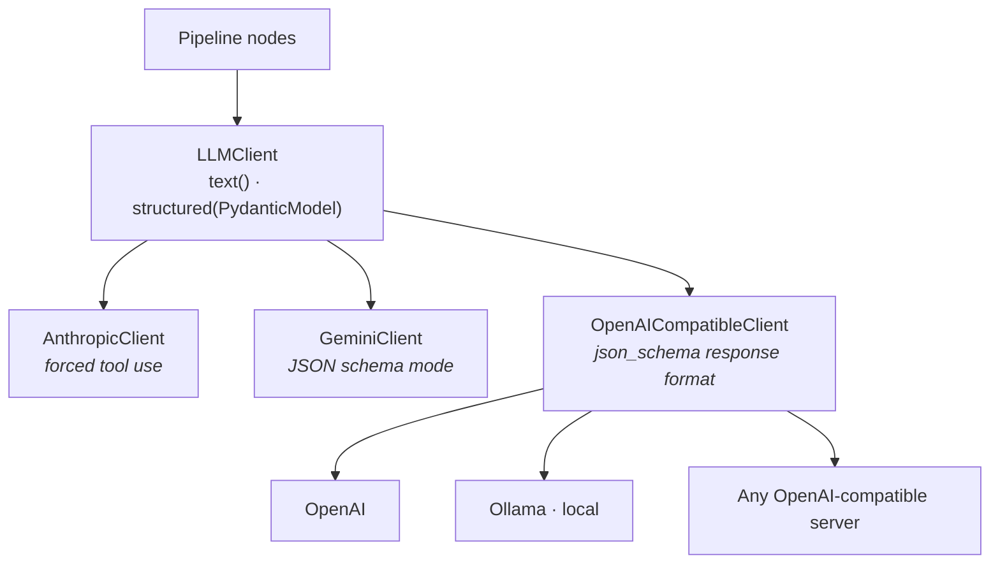

<div align="center">

# 🥫 Kasauti

**A touchstone for packaged food.**
Scan a label, get a verdict made for *you*.

*Kasauti* (कसौटी) is the touchstone jewellers use to test whether gold is pure.




</div>

---

## Why

Packaged-food labels are hard to read: INS numbers, "multigrain" claims on refined-flour biscuits, sugar under
five different names. Generic health scores ignore *you*. A biscuit that's fine for one person can be a bad
idea for someone with diabetes, high blood pressure or a peanut allergy.

Kasauti reads the label (photo, pasted text or barcode) and gives a **Safe / Moderate / Risky** verdict
**personalised to your health conditions and allergies**. Every reason traces back to the label and to a curated,
sourced knowledge base.

## Highlights

- **Rules decide, LLMs only read and explain.** The verdict is computed by deterministic rules, so it's
  consistent, testable and explainable. The LLM never gets a vote.
- **Pluggable LLMs:** Anthropic Claude, Google Gemini, OpenAI, or a **local Ollama model** (free and private), or
  **fully offline** with no AI at all.
- **Built for Indian labels:** understands `Emulsifiers (322, 471)`, `INS 150d`, maida, palmolein, vanaspati, jaggery,
  besan, FSSAI rules.
- **Personalised:** 8 health conditions (diabetes, hypertension, kidney disease, PKU, celiac, pregnancy, gout, weight
  loss), 12 allergen groups, and region-aware regulatory rules (India / EU / US).
- **Catches misleading claims:** "Multigrain" with refined flour first, "No added sugar" with jaggery or glucose,
  "High protein" at 5% of calories, "No preservatives" next to a preservative.
- **Honest confidence:** low-quality reads and unknown ingredients lower the confidence score. AI-classified
  ingredients are marked *unverified* and can never trigger a hard stop.
- **Web UI, REST API, CLI and Python library**, with 36 tests that run offline.

## Screenshots

| Dark mode: high BP + peanut allergy, offline rules | Phone: a "Safe" result |
|---|---|
|  |  |

<sub>All products shown are fictional sample labels from <code>samples/</code>.</sub>

## How it works



| Step | Who decides | What happens |
|---|---|---|
| **Lookup** | API | Barcode → [Open Food Facts](https://world.openfoodfacts.org). Cached for a week. |
| **Extract** | LLM (vision) | One call reads ingredients, nutrition per 100 g, pack claims and allergen statements into a typed schema. Cached per image, so each product is read once. Typed text is cross-checked by a deterministic parser. |
| **Analyze** | **Rules** | E/INS codes and ingredient matching, allergens, nutrient thresholds, condition rules, regulatory status, NOVA-style processing markers, claim checks. |
| **Enrich** | LLM, capped | Only for ingredients the knowledge base doesn't know. One batched call, cached per ingredient, marked *unverified*, capped at "moderate". |
| **Score** | **Rules** | Points per signal → 0–10 score → verdict. Hard stops override the score. |
| **Explain** | LLM | Plain-language summary in the user's language. It can't change the verdict, and falls back to a template if the LLM fails. |

### Provider layer



Every provider returns the same validated Pydantic objects. The shared layer handles schema inlining, a repair retry
for invalid JSON, detection of models that echo the schema back, and fail-fast errors for bad keys or an unreachable
Ollama.

### Scoring

| Signal level | Points | Examples |
|---|---|---|
| `low` | 0.5 | a single cosmetic additive; an additive restricted in another region |
| `moderate` | 1.5 | medium sugar or salt, synthetic azo dyes, non-sugar sweeteners |
| `high` | 3.0 | sugar above 22.5 g/100 g, hydrogenated fat, titanium dioxide |
| `avoid` | hard stop | your allergen, gluten with celiac, aspartame with PKU, an additive banned in **your** region |

`< 3` → **Safe** · `3 – 6.5` → **Moderate** · `≥ 6.5` or any hard stop → **Risky**.
Nutrient thresholds follow the UK FSA front-of-pack criteria (halved for drinks) and get stricter per condition
(for example, sugar above 10 g/100 g is "high" for diabetes). Misleading claims are shown but don't add points:
they're about honesty, not nutrition.

## Quick start

```bash
git clone https://github.com/umangbagadi03/kasauti.git && cd kasauti
python3 -m venv .venv && source .venv/bin/activate
pip install -r requirements.txt
cp .env.example .env          # add a key for the provider(s) you want, or use Ollama / offline
python -m kasauti serve       # → http://127.0.0.1:8000  (API docs at /docs)
```

### Providers

| Provider | Env key | Default model | Notes |
|---|---|---|---|
| `anthropic` | `ANTHROPIC_API_KEY` | `claude-sonnet-5-5` | structured output via forced tool use |
| `gemini` | `GEMINI_API_KEY` | `gemini-2.5-flash` | low cost for vision |
| `openai` | `OPENAI_API_KEY` | `gpt-5-mini` | `OPENAI_BASE_URL` works for any OpenAI-compatible server |
| `ollama` | – | `llama3.2-vision` | free and private; any local model works for text, a vision model for photos |
| *offline* | – | – | `--no-llm` / `use_llm=false`: rules only, for text and barcode input |

Pick the default with `LLM_PROVIDER`, or choose per request.

## Usage

**CLI**

```bash
python -m kasauti analyze --image label.jpg --condition diabetes --allergy peanut
python -m kasauti analyze --text-file samples/biscuit.txt --provider ollama --model llama3.2
python -m kasauti analyze --barcode <EAN-13 barcode> --language Hindi
python -m kasauti providers
```

```text
$ python -m kasauti analyze --text-file samples/namkeen.txt --condition hypertension --allergy peanut --no-llm

Product
🔴 RISKY   score 10.0/10   confidence 80%   (offline)

Best avoided or kept rare. Main reasons: may contain peanut; high fat; high saturated fat.

  🔴 May contain peanut
      You listed this as an allergy/intolerance.
  🔴 High fat
      Fat is 38g per 100 g; above 17.5g counts as high.
  🔴 High saturated fat
      Saturated fat is 16g per 100 g; above 5g counts as high.
  🔴 High sodium
      Sodium is 820mg per 100 g; above 400mg counts as high (stricter limit for hypertension).
  🟠 TBHQ (E319)
      Synthetic antioxidant in fried snacks and oils; EFSA ADI 0.7 mg/kg bw. Animal studies raise questions about immune effects.
  🟠 Ultra-processed
      2 industrial ingredient(s)/cosmetic additive(s): Disodium Guanylate, Disodium Inosinate.

Tips:
  • Pick a lower-salt option (under 120mg sodium per 100g is 'low').
  • Prefer products with a short ingredient list of foods you recognise.

Informational only — not medical advice.
```

**REST API**

```bash
curl -F image=@label.jpg \
     -F 'profile={"conditions":["diabetes"],"allergies":["milk"],"region":"IN","language":"Hindi"}' \
     -F provider=anthropic \
     http://127.0.0.1:8000/analyze
```

| Endpoint | |
|---|---|
| `GET /` | web UI |
| `POST /analyze` | multipart: `image` · `text` · `barcode` · `profile` (JSON) · `provider` · `model` · `use_llm` |
| `GET /providers` | which providers are configured |
| `GET /health` | status |
| `GET /docs` | interactive OpenAPI docs |

**Python**

```python
from kasauti import analyze, UserProfile

result = analyze(
    image=open("label.jpg", "rb").read(),
    profile=UserProfile(conditions=["hypertension"], allergies=["peanut"], language="Hindi"),
    provider="gemini",
)
print(result.verdict, result.score, result.explanation)
for signal in result.signals:
    print(signal.level, signal.title, "—", signal.detail)
```

## Knowledge base

The knowledge base, not the LLM, is the source of truth. It's plain JSON so it's easy to review and extend:

| File | Contents |
|---|---|
| [`additives.json`](kasauti/knowledge/additives.json) | 87 E/INS additives: category, risk, plain-language note, sources (EFSA, FSSAI, US FDA, IARC, WHO, JECFA), regions where not permitted, condition-specific levels |
| [`ingredients.json`](kasauti/knowledge/ingredients.json) | 42 ingredient groups (240+ label phrases: sugars, refined grains, fats, flavourings…) and 180+ whole foods |
| [`rules.py`](kasauti/knowledge/rules.py) | nutrient thresholds, condition overrides, claim checks |

The matcher handles real label formatting: nested brackets, `E471` / `INS 471` / `(471)` / `150(d)`, percentages,
"may contain" statements, and allergen look-alikes ("cocoa butter" and "coconut milk" are not dairy, and maltodextrin
is not gluten).

## Project structure

```
kasauti/
├── llm/              provider clients behind one interface (anthropic · gemini · openai + ollama)
├── knowledge/        additives.json · ingredients.json · rules.py · label matcher
├── nodes/            lookup · extract · analyze · enrich · score · explain
├── graph.py          LangGraph wiring
├── pipeline.py       analyze(...) entry point
├── api.py            FastAPI app
├── static/           web UI (single file, no build step)
└── __main__.py       CLI
tests/                36 tests, offline, with a fake LLM
samples/              fictional label texts
docs/screenshots/     README images
legacy/               the original prototype, kept for reference
```

## Testing

```bash
pytest -q
```

The suite runs fully offline. A `FakeLLM` stands in for real providers to test the extract → enrich → explain flow,
fallbacks when an LLM fails, the risk cap on AI-classified ingredients, JSON repair, and the API.

## Roadmap

- [ ] Evaluation set of real label photos, with accuracy compared across providers
- [ ] Dietitian review of thresholds and condition rules
- [ ] More regional-language label support
- [ ] Mobile app with on-device barcode scanning and OCR

## Disclaimer & data

Kasauti is an educational project. Its output is informational only — **not medical or nutritional advice** — and
reflects the rules and sources in `kasauti/knowledge/`, not a judgement on any brand or manufacturer. Verdicts can be
wrong (for example if a label is misread); always check the actual label and consult a doctor or dietitian about your
diet. All sample labels and products shown are fictional.

Barcode data comes from [Open Food Facts](https://world.openfoodfacts.org) (Open Database License).

---

<div align="center"><sub>Built by <a href="https://github.com/umangbagadi03">Umang Bagadi</a></sub></div>
